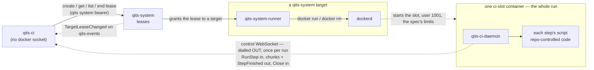
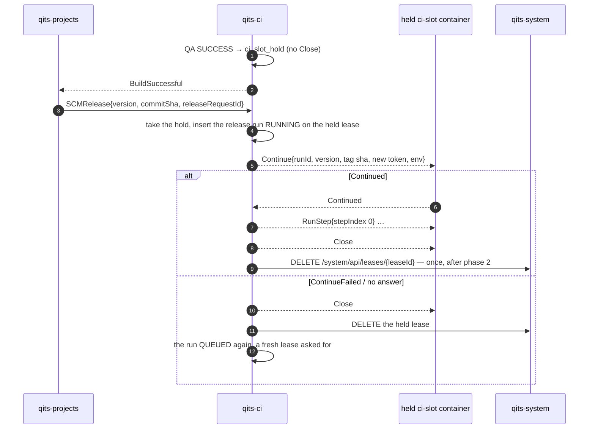

# How a run actually runs — the picture

`README.md` is the contract; this file draws it. Since epic qits-1481 a run is **one CI lease on a
qits-system target**: every step of the run executes in the same `qits/build-images/ci-slot`
container, driven over one control WebSocket. There are no runners, no runner socket and no
container per step any more, and no step ever gets a docker socket.

| | the control WebSocket | the lease |
|---|---|---|
| what | `wss://ci.qits.<domain>/ci/daemon`, qits-ci's public name behind the platform edge (composed from `QITS_DOMAIN`) | `POST /system/api/leases` at qits-system: slot type `CI`, owner `qits-ci`, owner ref the run id |
| who opens it | the slot's **`qits-ci-daemon`**, dialling **out** through the edge; qits-ci never dials in | qits-ci, once per run, when the run is queued |
| what rides it | every step's script one way (`RunStep`), output chunks and lifecycle frames the other, and the run's `Close` | the slot's spec — image pinned by digest, environment, user `1001`, limits — and the lease's state |
| what it grants | "deliver data about this run", authenticated by the run's `ci-run` token; the launch is named in the daemon's first frame | one container on one target for as long as the run holds the lease |
| if it goes wrong | the step is recorded `NEVER_STARTED` / `CONNECTION_LOST` | a lease that ends `FAILED` or `EXITED` before the daemon said `Initialized` is the run's first step `LAUNCH_FAILED`, with the lease's own words |



**One address plane.** The slot joins no docker network qits-ci knows of. Every address it is told is
the public name of a service, `https://<host>.qits.<domain>`, reached through the platform edge with
the run's token: qits-ci's daemon socket, the git host it clones from, the registry, the mirror,
qits-workspaces.

**No docker in a step.** A step that declares `docker: true` is `CONFIG_ERROR` with `docker steps are
not supported: steps run in qits/build-images/ci-slot without Docker` — the run is recorded with that
step failed, and nothing is leased. A step's `image:` is ignored, and the first step's output says so
once: `step images are ignored: every step runs in qits/build-images/ci-slot`. `build: true` stays:
an image build is the target's builder's (`$BUILDKIT_HOST`, which the target sets and the spec may
not).

## The whole flow, once

```mermaid
sequenceDiagram
    autonumber
    participant Proj as qits-projects
    participant Bus as qits-events
    participant Git as qits-githost
    participant Ci as qits-ci
    participant Idp as qits-idp
    participant Sys as qits-system
    participant Tgt as target (qits-system-runner)
    participant Slot as ci-slot container

    Proj->>Bus: ReleaseRequestChanged{repository, backingBranch, mergedSha}
    Bus-->>Ci: the frame (durably; a catch-up sweep reads it back)
    Ci->>Git: the pipeline files at the event's revision — no clone
    Ci->>Ci: accept: the run row QUEUED, the ci-slot image pinned by digest
    Ci->>Idp: POST /idp/api/tokens {contextKind: ci-run, contextId: runId}<br/>BEFORE the lease, so nothing can be granted that has no token
    Ci->>Sys: POST /system/api/leases {CI, runId, priority, spec}<br/>spec: image@digest, env (no per-step parts), user 1001, qits.ci.slot.* limits
    Ci->>Ci: record lease_id and the launch (daemon id, token subject) on the row
    Sys->>Tgt: grant, by priority desc then requested_at
    Tgt->>Slot: docker run — the slot starts
    Sys-->>Ci: TargetLeaseChanged{RUNNING, targetId} (and every 30 s reconcile)
    Slot->>Slot: entrypoint runs $QITS_CI_BOOTSTRAP (as 1001, HOME=/work/home):<br/>fetch the pinned qits-ci-daemon with $QITS_TOKEN, write credentials, exec it
    Slot-->>Ci: dials the control WebSocket as the run's token, Hello{daemonId}
    Note over Ci: the dial is also a cue: qits-ci reads the lease and claims the run<br/>(RUNNING, target_id) if no event got there first
    Slot->>Git: clone with the token, checkout $QITS_CI_SHA
    Slot-->>Ci: Initialized

    loop every step, on the same connection
        Ci-->>Slot: RunStep{correlationId, stepIndex, script, timeoutSeconds, env{QITS_CI_STEP_INDEX}}
        Slot-->>Ci: StepChunk … — the bounded relay behind GET /ci/api/runs/{runId}'s `live`
        Slot-->>Ci: StepFinished{stepIndex, exitCode, timedOut}
        Ci->>Ci: write the step row ONCE, already terminal
    end

    alt a green release-request QA run whose slot can be held (qits-732)
        Ci->>Ci: ci_slot_hold row — no Close, the lease and the token kept
        Ci->>Bus: BuildSuccessful
        Note over Ci,Slot: until SCMRelease adopts the slot (Continue, below) or a release trigger ends the hold
    else every other run
        Ci-->>Slot: Close — the daemon exits
        Ci->>Sys: DELETE /system/api/leases/{leaseId}
        Ci->>Idp: DELETE /idp/api/tokens/{tokenId}
        Ci->>Bus: BuildSuccessful on SUCCESS; BuildFailed with the terminal word otherwise
    end
```

Four things the diagram is deliberately precise about:

- **One lease, one container, one connection per run — per release request where it can be held**
  (epic qits-732: a green QA run's slot is held for the release run, which continues in it; see
  "Holding the slot between the phases" below). The clone happens once, and every step
  sees what the steps before it left in the worktree. The `seq` of the output chunks runs across
  the whole lease, and the daemon ignores a `RunStep` naming an index it has already run, which is
  what makes a resend after a reconnect safe.
- **The script arrives as a reply.** qits-ci initiates nothing toward a container and never touches
  docker. The first `RunStep` answers the daemon's `Initialized`; each later one follows the previous
  `StepFinished`.
- **The token comes first and goes last.** It is minted before the lease is asked for and deleted
  when the run closes, or as soon as the lease is seen to have ended, whichever comes first.
- **The row is written once, terminal.** While a step runs it has no row; `live` is what makes that
  legible.

## Holding the slot between the phases (qits-732)

A release request has two CI phases: QA on the fold (`ReleaseRequestChanged`, phase 1) and the tag
build (`SCMRelease`, phase 2). The tag is the fold plus a version commit, so a fresh lease for phase
2 pulls the same multi-GB image, clones the same tree and rebuilds what phase 1's container already
has warm. So phase 1's container is kept for phase 2 where it can be:

- **The hold.** A QA run that settles `SUCCESS`, composed from `release.yml` (every such composition
  has a release half), on a daemon whose `Hello` announced capability 3, with its lease alive and
  `qits.ci.release-hold.enabled` on, is not closed. A `ci_slot_hold` row is written **before**
  `BuildSuccessful` leaves; the lease, the daemon and the phase-1 token stay as they are.
- **Why the QA run still settles.** qits-projects holds a release request while
  `GET /ci/api/runs/active` lists a run of its `(repoId, commitSha)` (`HttpActiveBuilds`). The hold
  is therefore no run status: the QA run is `SUCCESS`, announced, and gone from `/runs/active` as
  ever, or the request would wait on its own held slot forever.
- **Adoption.** When `SCMRelease` accepts the phase-2 run and a hold exists for its
  `(repoId, releaseRequestId)`, the hold is taken atomically and the run is inserted `RUNNING` on the
  held lease — `lease_id`, `target_id`, `daemon_version` copied, `continued_from_run_id` set — never
  `QUEUED`, so no ordering and no lease request ever sees it. Its own `ci-run` token is minted, the
  launch is re-keyed to the run and the new token's subject (the daemon's re-dials present the new
  token from then on), and the daemon is sent
  `Continue{runId, branch: <version>, sha: <tag commit>, token, env}` (`env` is
  `CiSlotSpecs.runEnv`, the run-scoped subset of the lease spec).
- **`Continued`** moves the worktree to the tag. The phase-1 token is revoked and the run is driven
  on its `ci-run-<runId>` thread from step **0** — the daemon counts the new run's steps afresh, the
  output `seq` goes on counting. Phase 2 closes the lease at its end as any run does, and is never
  held itself.
- **`ContinueFailed`**, no answer within `qits.ci.daemon-init-timeout-seconds`, or the daemon or the
  lease gone before the answer: the held lease is ended (`Close`, `DELETE`, both tokens revoked) and
  the run goes back to `QUEUED` with no lease, target, pin or `continued_from_run_id`, and asks a
  lease of its own. No verdict is announced and no automatic retry is counted — nothing ran.
- **Release triggers.** A hold nothing adopts ends on the first of: `ReleaseRequestStateChanged` in
  REJECTED/FAILED/CONFLICTED/WITHDRAWN/OBSOLETE, `ApprovalRequirementChanged` OPEN on the held fold,
  `qits.ci.release-hold.timeout` (PT60S), the lease seen ended, the daemon lost past its reconnect
  grace, a newer hold of the same request, or a qits-ci restart.



## When the lease does not get that far

- **qits-system does not answer** the create: nothing is recorded, the run stays `QUEUED`, and the
  reconcile asks again.
- **The lease ends `FAILED` or `EXITED` before `Initialized`** (an image the target refused, a spec
  the policy rejected, a slot that died booting): the run is claimed anyway and its first step is
  `LAUNCH_FAILED` with the lease's detail, so the verdict names the cause.
- **A lease no live run names** (a run settled while its lease was queued, a previous process's
  leftovers) is ended by the reconcile once it is older than two minutes.
- **qits-ci restarts mid-run.** The lease outlives the process. The launch and the in-flight step are
  on the row (`lease_id`, `inflight_*`), the successor registers the launch again under its old id,
  the re-dialling daemon is admitted as that launch, and the run continues at the first step without
  a row — the in-flight one taken back, never started twice (qits-1192, kept for leases).
- **A queued run holding a lease a previous process asked for** has that lease ended and a fresh one
  requested, since its launch was never recorded in this process.

## Where a publishing step fits

A publishing step is a step like any other: its script calls `qits artifacts publish …` or drives
`buildctl` against `$BUILDKIT_HOST`, the target's builder, which pulls the bases through the mirror
and pushes to `registry.qits.$QITS_DOMAIN` with the run's token. The push is the step's exit code: a
failed push is a failed step is a failed run, so `SoftwareRelease` — one per published declaration,
announced by qits-ci only after the run is green and the release is real — keeps implying the
artifact exists.
